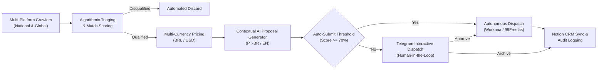

# GigFlow: Autonomous Freelance Intelligence and Bidding Engine

GigFlow is an enterprise-grade autonomous pipeline designed for opportunity discovery, technical qualification, dynamic pricing, and automated proposal submission across Brazilian and international freelancing ecosystems.

Built with Python and managed deterministically via Astral `uv`, the platform operates under a zero-overhead infrastructure model, eliminating the need for paid proxies or third-party orchestrators.

---

## Architecture Overview



---

## Core Capabilities

### 1. Multi-Platform Scouting
GigFlow actively monitors and aggregates opportunities across high-volume contract networks:
- National Portals: 99Freelas, Workana (Brazil / LatAm), LinkedIn (Remote Contractor / PJ).
- Global Portals: RemoteOK, Remotive, Freelancer.com, WeWorkRemotely, LinkedIn Worldwide.

### 2. Algorithmic Match Scoring and Noise Filtering
Every incoming opportunity undergoes structured text parsing across four primary technical pillars:
- Data Science and Machine Learning: Predictive modeling (XGBoost), MLOps, Streamlit, dbt, PostgreSQL, analytics engineering, and statistics.
- OSINT and Cybersecurity: Threat intelligence, forensic analysis, reconnaissance, automated open-source data collection, and defensive security.
- Process Automation and Web Scraping: Headless browser automation (Patchright, Playwright, BeautifulSoup), REST APIs, and RPA.
- Software Engineering and Backend: Python, FastAPI, Docker microservices, Linux shell automation, and backend architectures.

The filtering engine automatically discards irrelevant postings, including active telemarketing, paid advertising campaigns, manual social media editing, on-site/hybrid positions, and executive management roles.

### 3. Dynamic Multi-Currency Pricing Engine
A rules-based pricing engine evaluates scope and technical complexity across four tiers:
- Tier 0: Administrative and micro-tasks (data entry, transcription, customer support).
- Tier 1: Scripting, standalone scrapers, and task-specific automation.
- Tier 2: Dashboards, end-to-end data pipelines, and REST APIs.
- Tier 3: MLOps pipelines, predictive modeling, Dockerized systems, and security audits.

The engine calculates estimated labor hours, delivery windows, and native platform commission overhead for both Brazilian Real (BRL) and US Dollar (USD) contracts.

### 4. Bilingual AI Proposal Generation
Proposals are drafted using Google Gemini LLM with a deterministic template fallback:
- Language Detection: Automatically matches client language (Portuguese or English).
- Portfolio Contextualization: Integrates real production repositories and domain experience.
- Tone Adaptation: Direct, technical, and objective value propositions without sales fluff.

### 5. Human-in-the-Loop Governance
Opportunities below the autonomous dispatch threshold trigger interactive cards via Telegram:
- One-touch dispatch to submit directly to supported platforms.
- Monospaced proposal view for instant mobile clipboard copy.
- Real-time synchronization to Notion CRM.

---

## Prerequisites

- Operating System: Linux (recommended), macOS, or Windows WSL2.
- Python: Version 3.12 or higher.
- Package Manager: `uv` (Fast Python package installer and resolver).
- Browser Engine: Google Chrome, Chromium, or Brave for session state preservation.

---

## Installation

### 1. Clone the Repository

```bash
git clone git@github.com:RicsonRamos/gigflow.git
cd gigflow
```

### 2. Synchronize Virtual Environment

Using `uv`, synchronize project dependencies and install browser runtime binaries:

```bash
uv sync
uv run playwright install chromium
```

---

## Configuration

Duplicate the environment template and populate your operational parameters:

```bash
cp .env.example .env
```

### Environment Parameters (.env)

```ini
# Telegram Bot Integration (BotFather)
TELEGRAM_BOT_TOKEN=your_telegram_bot_token_here
TELEGRAM_CHAT_ID=your_telegram_chat_id_here

# Notion CRM Integration (notion.so/my-integrations)
NOTION_API_KEY=your_notion_api_key_here
NOTION_DATABASE_ID=your_notion_database_id_here

# Google Gemini API (Optional - ai.google.dev)
GEMINI_API_KEY=your_gemini_api_key_here

# Execution and Governance Controls
SIMULATE_DRY_RUN=false
AUTO_SUBMIT_PROPOSALS=true
AUTO_SUBMIT_MIN_SCORE=70
MAX_DAILY_PROPOSALS=10
SCRAPE_INTERVAL_MINUTES=15

# International Market Expansion
ENABLE_INTERNATIONAL=true
INTERNATIONAL_KEYWORDS=python,data,scraping,automation,fastapi,streamlit,etl,sql
MIN_BUDGET_USD=80
HOURLY_RATE_USD=35
```

---

## Operational Execution Modes

### Single Diagnostic Scan
Executes a single end-to-end extraction across all configured platforms, scores matches, and reports findings:

```bash
uv run python main.py --scan
```

### Continuous Daemon Mode (Production)
Runs the continuous background scheduler alongside the interactive Telegram bot listener:

```bash
uv run python main.py --daemon
```

### Telegram Bot Listener Only
Launches the standalone Telegram bot listener for interactive project review:

```bash
uv run python main.py --bot
```

### Session State Capture (Authentication)
Captures authenticated browser sessions for platforms protected by anti-bot verification:

```bash
# Automated browser login capture
uv run python main.py --login workana
uv run python main.py --login 99freelas
uv run python main.py --login linkedin

# Manual cookie import via data/cookies.txt
uv run python main.py --login workana --manual
```

### Infrastructure Connectivity Verification

```bash
# Verify Telegram bot credentials
uv run python main.py --test-telegram

# Verify Notion database schema and credentials
uv run python main.py --test-notion
```

---

## Telegram Bot Interface

When running in Daemon or Bot mode, the bot handles operational workflows via chat commands:

| Command | Action Description |
| :--- | :--- |
| `/scan` | Triggers an immediate background extraction across all platforms |
| `/pendentes` | Displays pending opportunities awaiting manual approval |
| `/status` | Summarizes daily submissions, quota utilization, and total indexed jobs |
| `/enviar <job_id>` | Forces immediate submission of a targeted proposal |
| `/ajuda` | Displays command usage and status dashboard |

---

## Project Structure

```
gigflow/
├── pyproject.toml              # Project metadata and dependency definitions
├── uv.lock                     # Deterministic dependency lockfile
├── config.py                   # Platform settings, keyword taxonomies, and fee tables
├── .env.example                # Sanitized environment configuration template
├── .gitignore                  # Security-first exclusion patterns
├── main.py                     # CLI entrypoint and runtime orchestrator
├── bot/
│   └── telegram_bot.py         # Human-in-the-loop interactive Telegram agent
├── core/
│   ├── ai_proposal.py          # LLM and deterministic proposal generator
│   ├── auth_manager.py         # Stealth browser session and cookie persistence
│   ├── database.py             # SQLite data persistence and quota enforcement
│   ├── notion_crm.py           # Notion REST API CRM synchronization client
│   └── pricing_engine.py       # Dynamic pricing, complexity, and fee calculator
├── platforms/
│   ├── base_platform.py        # Base adapter contract and scoring algorithms
│   ├── noventa_nove_freelas.py # 99Freelas platform adapter
│   ├── workana.py              # Workana platform adapter
│   ├── remoteok.py             # RemoteOK global contract adapter
│   ├── remotive.py             # Remotive international opportunities adapter
│   ├── weworkremotely.py       # WeWorkRemotely scraper adapter
│   ├── freelancer.py           # Freelancer.com scraper adapter
│   └── linkedin.py             # LinkedIn contractor opportunities adapter
└── data/
    ├── .gitkeep                # Directory anchor
    └── sessions/
        └── .gitkeep            # Session state storage directory anchor
```

---

## Security and Compliance Standards

- Strict Credential Isolation: Sensitive values are exclusively managed through `.env` files and environment variables.
- Zero Hardcoded Secrets: All network requests, API clients, and database layers reference dynamic environment variables.
- Quota Rate Limiting: Hard limits on daily proposal dispatches (`MAX_DAILY_PROPOSALS`) mitigate platform rate-limiting and anti-bot triggering.
- Local-First Data Storage: SQLite stores tracking states locally; credentials and cookies are strictly excluded from version control.

---

## License

This project is licensed under the MIT License. See the LICENSE file for details.
